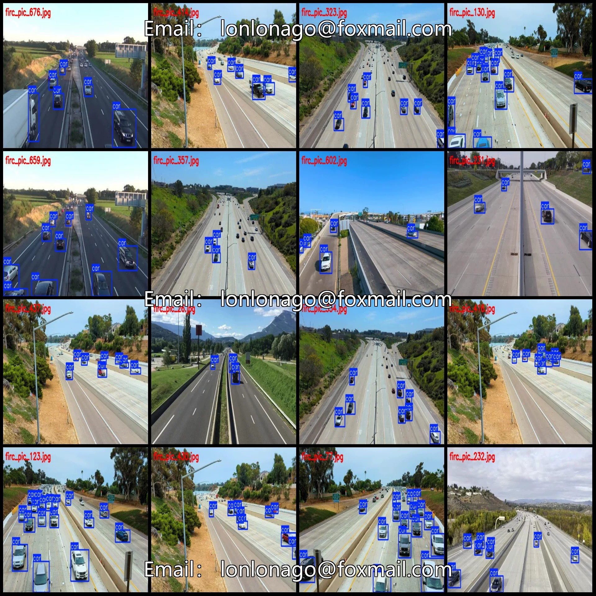
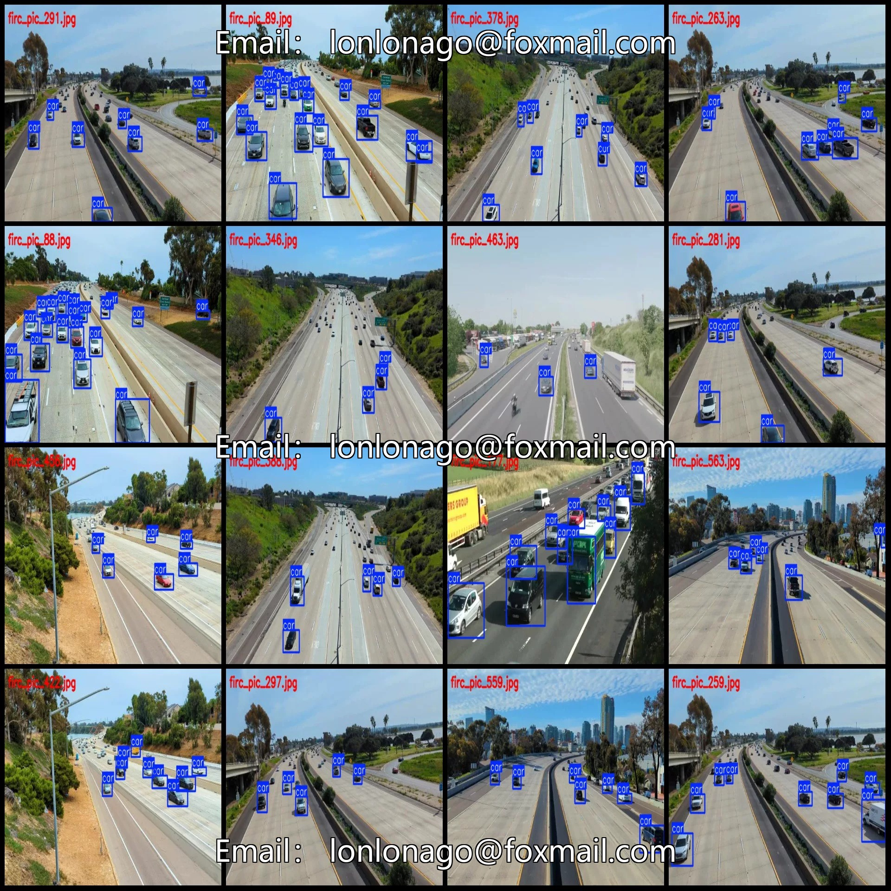
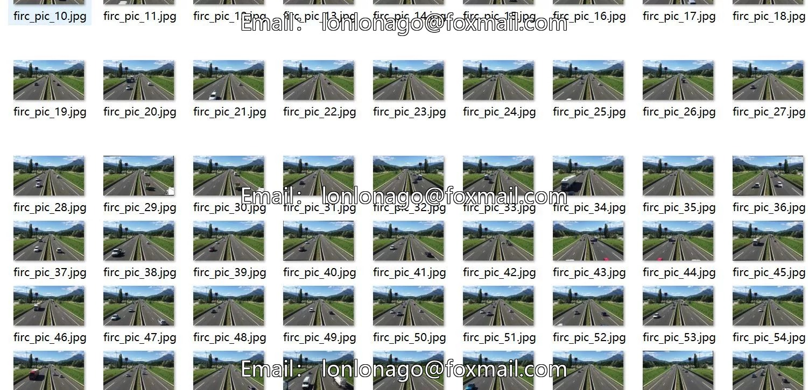
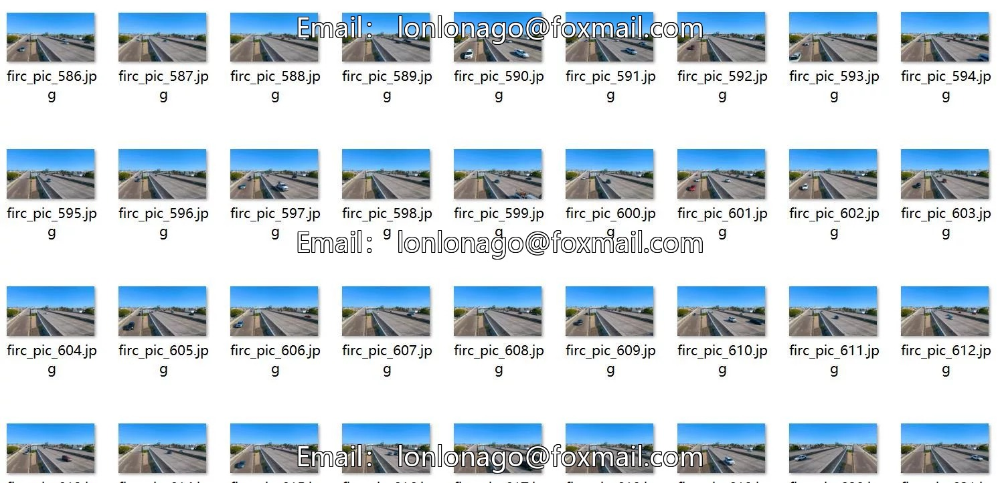
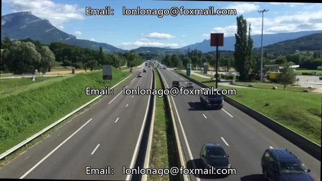
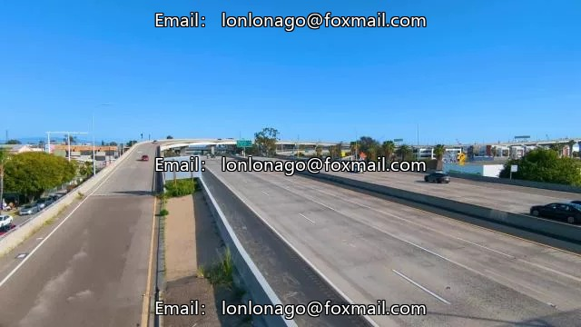
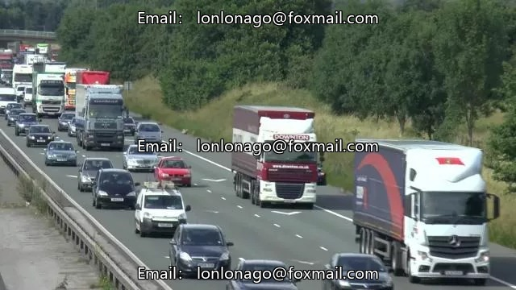

# Drone-view aerial photography dataset for highway vehicle inspection and detection in VOC+YOLO format

## Body

1. Vehicle inspection dataset in drone perspective aerial photography format: VOC+YOLO
2. Purchasers are reminded that the dataset is copyable, and after purchase, please confirm compliance before purchasing.
3. The dataset format includes Pascal VOC format + YOLO format (excluding split paths in txt files, only containing jpg images along with corresponding VOC format xml files and yolo format txt files).
4. Number of images (number of jpg files): 727
5. Number of annotations (number of xml files): 727
6. Number of annotations (number of txt files): 727
7. Number of annotation categories: 1
8. Annotation category names: ["car"]

Car Frames = 5977, Image Count = 727
Total Frames: 5977
Image Resolution: 640x360
Labeling Tool: labelImg
Labeling Rules: Draw a rectangle around the category, do not label beyond 10 meters.
Important Notice: The dataset does not include splitting into training, validation, and test sets; you need to do this yourself.
Special Remark: This dataset does not guarantee the accuracy of the trained model or weight files.

## Images

## Payment

Here is a pay link on Stripe ( https://buy.stripe.com/3cs8yP7sY87d0vu9AB ). Please contact me lonlonago@foxmail.com after funding $89, and I will send you a complete data files , thank you!

